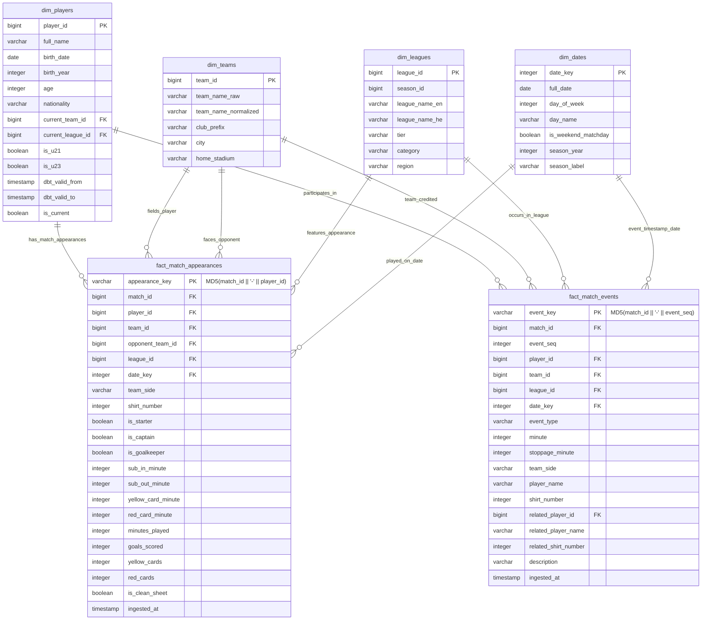
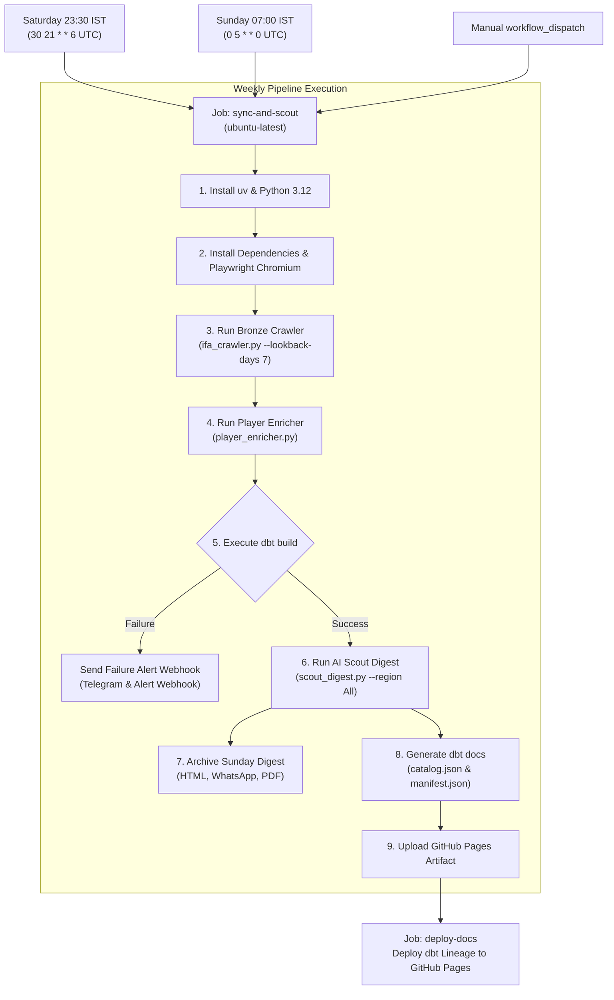

# ⚽ `il-scout-engine` — Israeli Lower-League & Youth Football Scouting Lakehouse

[](https://github.com/Brahamim42/ifl-moneyball/actions/workflows/weekly_scout_sync.yml)
[](dbt_project/)
[](pyproject.toml)
[](https://github.com/astral-sh/uv)
[](https://duckdb.org/)
[](https://playwright.dev/)
[](app.py)
[](src/reporting/scout_digest.py)

> An end-to-end, production-grade **Data Engineering & Lakehouse Scouting Platform** (and solo micro-SaaS) that discovers and tracks undervalued U21/U23 breakout football prospects across Israel's lower senior tiers (Liga Alef, Liga Bet, Liga Gimel) and top youth divisions (Liga Leumit LaNoar).

---

## 📌 Executive Summary & The Business Problem

### The Israeli Football Scouting Void
In professional Israeli football, clubs in the top two divisions (**Ligat Ha'Al** and **Liga Leumit**) rely on expensive commercial scouting platforms (Wyscout, InStat / Hudl). However, tiers 3 through 5 (**Liga Alef**, **Liga Bet**, and **Liga Gimel**) along with the U19 youth leagues (**Liga Leumit LaNoar**) have **virtually zero automated data infrastructure or performance analytics**.

This data void creates significant inefficiencies:
* **Overlooked Breakout Prospects:** High-upside U19/U21 players playing senior football in Tier 3–5 or dominating youth divisions remain invisible to professional clubs and scouting agencies until they are older or priced up.
* **No Centralized Transfer Tracking:** Hundreds of lower-league players move between clubs during the season; without point-in-time tracking, historical performance data gets misattributed to new clubs.
* **Hebrew Text & Disparate Formats:** Match sheets, lineups, disciplinary events, and player biographies on the Israel Football Association ([football.org.il](https://www.football.org.il/)) portal are rendered in non-standardized Hebrew DOM structures without a public REST API.

### The Solution: `il-scout-engine`
`il-scout-engine` democratizes lower-tier scouting by turning the IFA portal into a **zero-cost, decoupled cloud lakehouse**:
1. **Automated Ingestion (Bronze):** Async Playwright crawls all 10 target divisions, enforces strict Pydantic v2 data contracts, maintains an idempotent match watermark with lookback windows, and stores immutable Hive-partitioned Parquet files backed up to Cloudflare R2 / AWS S3.
2. **Kimball Star Schema & SCD Type 2 (Silver):** DuckDB / MotherDuck orchestrated by `dbt-duckdb` models match appearances and in-game events into clean facts and dimensions, featuring **Slowly Changing Dimensions (SCD Type 2)** to accurately preserve historical club affiliations across mid-season transfers.
3. **Advanced Scouting Marts (Gold):** Computes rolling 5-match window metrics, Non-Penalty Goals per 90 (`npg_per_90`), team goal share (`team_goal_share_pct`), league Z-Scores (`league_z_score`), scout flags (`is_u21_ironman`, `is_sudden_role_breakout`, `is_youth_senior_callup`), and a weighted **`breakout_index` (0–100)**.
4. **AI Scouting Analyst & UI (Intelligence):** Grounded Anthropic Claude AI generates strictly fact-based Hebrew scouting notes delivered in an RTL HTML Sunday Digest and WhatsApp summaries, while an interactive 3-tab **Streamlit Explorer** gives scouts immediate talent discovery.
5. **CI/CD & Observability:** GitHub Actions runs weekend cron syncs, dispatches failure webhook alerts (Telegram/email), and continuously publishes `dbt docs` lineage graphs to GitHub Pages.

---

## 🏆 Target Scope: The 10 IFA Leagues

All crawler and warehouse logic is parameterized via [`config/leagues.yaml`](config/leagues.yaml) across 10 official IFA divisions:

| # | Division (English) | Official IFA Name (Hebrew) | Tier / Category | Region | Standard URL Pattern |
| :-: | :--- | :--- | :--- | :--- | :--- |
| **1** | **Liga Alef North** | ליגה א' צפון | Senior Tier 3 | North | `league_id=231` |
| **2** | **Liga Alef South** | ליגה א' דרום | Senior Tier 3 | South | `league_id=232` |
| **3** | **Liga Bet North A** | ליגה ב' צפון א' | Senior Tier 4 | North | `league_id=233` |
| **4** | **Liga Bet North B** | ליגה ב' צפון ב' | Senior Tier 4 | North | `league_id=234` |
| **5** | **Liga Bet South A** | ליגה ב' דרום א' | Senior Tier 4 | South | `league_id=235` |
| **6** | **Liga Bet South B** | ליגה ב' דרום ב' | Senior Tier 4 | South | `league_id=236` |
| **7** | **Liga Leumit LaNoar North** | ליגה לאומית לנוער צפון | U19 Tier 2 | North | `league_id=240` |
| **8** | **Liga Leumit LaNoar South** | ליגה לאומית לנוער דרום | U19 Tier 2 | South | `league_id=241` |
| **9** | **Liga Gimel Central** | ליגה ג' מרכז | Senior Tier 5 | Central | `league_id=245` |
| **10** | **Liga Gimel South** | ליגה ג' דרום | Senior Tier 5 | South | `league_id=247` |

---

## 🏗️ End-to-End Lakehouse Architecture

The system follows a modern **Medallion Lakehouse Architecture** (Bronze ➔ Silver ➔ Gold ➔ Intelligence):

```
                     ┌──────────────────────────────────────────────┐
                     │    IFA Portal (www.football.org.il)          │
                     │  - Matches, Round Ajax Lists, Player Bios    │
                     └──────────────────────┬───────────────────────┘
                                            │
                                            ▼  Async Playwright + selectolax + Pydantic v2
┌───────────────────────────────────────────────────────────────────────────────────────────┐
│ LAYER 1: BRONZE (Immutable Hive-Partitioned Parquet)                                      │
│                                                                                           │
│  • Storage: data/bronze/season_id=<ID>/league_id=<ID>/matches.parquet                     │
│                        data/bronze/season_id=<ID>/league_id=<ID>/appearances.parquet      │
│  • Cloud Mirror: Cloudflare R2 / AWS S3 via boto3 / DuckDB httpfs                         │
│  • Watermarking: Incremental skip of existing match_ids; --lookback-days 7 for stat edits │
│  • Bio Cache: data/bronze/players/bronze_players.parquet (timestamped player snapshots)   │
│  • Audit Trail: data/bronze/etl_run_logs.parquet (run_id, timing, row counts, errors)     │
└───────────────────────────────────────────┬───────────────────────────────────────────────┘
                                            │
                                            ▼  dbt-duckdb (staging views over Parquet)
┌───────────────────────────────────────────────────────────────────────────────────────────┐
│ LAYER 2: SILVER (Kimball Star Schema Data Warehouse)                                      │
│                                                                                           │
│  • Engine: DuckDB 2.0 (local development) / MotherDuck (cloud production)                 │
│  • Facts:                                                                                 │
│      - fact_match_appearances (Grain: match_id x player_id; calculated minutes_played)    │
│      - fact_match_events      (Grain: match_id x event_seq; goals, cards, substitutions)  │
│  • Dimensions:                                                                            │
│      - dim_players & snap_players_scd2 (SCD Type 2 tracking club & league transfers)      │
│      - dim_teams (Hebrew normalization macro: מ.ס./הפועל/מכבי prefix & sponsor cleanup)    │
│      - dim_leagues & dim_dates (full calendar dates + weekend matchday flags)             │
│  • Loading Strategy: Incremental MERGE on surrogate keys                                  │
└───────────────────────────────────────────┬───────────────────────────────────────────────┘
                                            │
                                            ▼  dbt Transformations & Window Functions
┌───────────────────────────────────────────────────────────────────────────────────────────┐
│ LAYER 3: GOLD (Analytical & Scouting Marts)                                               │
│                                                                                           │
│  • mart_player_season_stats: Season aggregates per (player_id, season_id, league_id)       │
│  • mart_breakout_prospects:                                                               │
│      - 5-match rolling window: npg_per_90, team_goal_share_pct, league_z_score            │
│      - Scout Tags: is_u21_ironman, is_sudden_role_breakout, is_youth_senior_callup         │
│      - Breakout Index (0–100 composite ranking)                                           │
│  • Quality Gates: 110 automated dbt schema tests + singular SQL constraint checks         │
└───────────────────────────────────────────┬───────────────────────────────────────────────┘
                                            │
                    ┌───────────────────────┴───────────────────────┐
                    ▼                                               ▼
┌───────────────────────────────────────┐       ┌───────────────────────────────────────┐
│ LAYER 4A: AI SCOUTING ANALYST         │       │ LAYER 4B: STREAMLIT EXPLORER UI       │
│                                       │       │                                       │
│ • Anthropic Claude 3.5 Haiku API      │       │ • Interactive 3-Tab RTL Hebrew App    │
│ • 100% Grounded (Zero Hallucination)  │       │ • Tab 1: Breakout Radar & Filters     │
│ • 2-sentence Hebrew scouting blurbs   │       │ • Tab 2: Player Deep-Dive & SCD2 Timeline│
│ • sunday_digest.html (RTL responsive) │       │ • Tab 3: Pipeline & Warehouse Health  │
│ • whatsapp_digest.txt (mobile digest) │       │ • Instant CSV Export (UTF-8 BOM)      │
└───────────────────────────────────────┘       └───────────────────────────────────────┘
```

---

## 📐 Kimball Star Schema & SCD Type 2 Transfer Tracking

### Dimensional Data Model (ERD)

The Silver layer transforms raw Bronze structures into an enterprise Kimball Star Schema:



### Why SCD Type 2 Matters in Football Warehousing
In football analytics, treating player biographical data as **Slowly Changing Dimension Type 1 (overwrite)** leads to severe data corruption. If Player X scores 8 goals for *Hapoel Migdal HaEmek* in September and transfers to *Maccabi Kiryat Ata* in January:
* An **SCD Type 1** pipeline overwrites `current_team_id`, erroneously showing Player X scoring 8 goals for *Kiryat Ata* in September match sheets.
* Our **SCD Type 2 (`snap_players_scd2`)** snapshot engine tracks changes to `['current_team_id', 'current_league_id']`, assigning `dbt_valid_from`, `dbt_valid_to`, and `is_current`:

```sql
-- Point-in-time join ensures goals are attributed to the exact club represented on matchday
select
    f.match_id,
    f.player_id,
    p.full_name,
    p.current_team_name_normalized as club_on_matchday
from fact_match_appearances f
join snap_players_scd2 p
  on f.player_id = p.player_id
 and f.match_date >= cast(p.dbt_valid_from as date)
 and (f.match_date < cast(p.dbt_valid_to as date) or p.dbt_valid_to is null)
```

### Accurate `minutes_played` Calculation
Lower-league IFA match sheets record substitution events (`sub_in_minute`, `sub_out_minute`) and red cards (`red_card_minute`), but never provide total minutes played. `fact_match_appearances` derives exact on-pitch duration:
```sql
case
    when is_starter and sub_out_minute is null and red_card_minute is null then 90
    when is_starter and sub_out_minute is not null then least(sub_out_minute, coalesce(red_card_minute, 90))
    when not is_starter and sub_in_minute is not null then
        greatest(0, least(coalesce(sub_out_minute, 90), coalesce(red_card_minute, 90)) - sub_in_minute)
    else 0
end as minutes_played
```

### Hebrew Club Name Normalization Macro
Club names in Israel are frequently entered with variable prefixes and commercial sponsor suffixes (e.g. `מועדון ספורט כפר קאסם סוהיב`, `מ.ס. כפר קאסם`, `הפועל עירוני גדרה`). The dbt macro [`macros/normalize_hebrew_club_name.sql`](dbt_project/macros/normalize_hebrew_club_name.sql) standardizes prefixes, strips whitespace, and removes commercial sponsor suffixes to guarantee 100% referential integrity across dimensional joins.

---

## 🎯 Gold Mart Metrics & AI Scouting Analyst

### Composite Breakout Index Formula
Prospects in [`mart_breakout_prospects`](dbt_project/models/gold/mart_breakout_prospects.sql) are filtered for `age <= 23` and `minutes_played >= 270`, computing a **Breakout Index (0–100)**:

$$\text{Breakout Index} = \min\left(100,\; \left( \text{Rolling NPG/90} \times 30 \right) + \left( \text{Goal Share \%} \times 0.25 \right) + \left( \text{Minutes Score} \right) + \text{Bonus Tags} \right)$$

* **`is_u21_ironman` (+10 pts):** Under-21 player completing $\ge 80\%$ of available senior league minutes.
* **`is_sudden_role_breakout` (+15 pts):** Bench player promoted to consecutive starting roles or scoring in consecutive substitute appearances.
* **`is_youth_senior_callup` (+15 pts):** Registered U19 player drafted into senior lower-league matches.

### Grounded Claude AI Blurb Engine
To eliminate LLM hallucinations, [`src/reporting/scout_digest.py`](src/reporting/scout_digest.py) enforces a **Zero-Hallucination Policy**:
* Claude 3.5 Haiku is injected only with the exact JSON metrics queried from the Gold warehouse.
* Subjective adjectives ("speedy", "great header", "dominant playmaker") are strictly forbidden by system prompt guardrails.
* Outputs **exactly 2 sentences** in professional Hebrew: Sentence 1 details hard statistical output; Sentence 2 contextualizes the player's breakout tag, league Z-score, and Breakout Index.

```
⚽ דוח סקאוטינג לדוגמה (Sunday Digest):
"עומר לוי (גיל 19) רשם העונה 6 שערים ב-640 דקות משחק במדי הפועל מגדל העמק, המהווים 38% מסך שערי הקבוצה
ובקצב של 0.84 שערים ל-90 דקות. הוא מוביל את דירוג הפורצים עם מדד Breakout Index של 88.5 ומשלים מעל 80%
מדקות הבוגרים כ-U21 איירונמן."
```

---

## 🤖 Production CI/CD & Weekend Automation

The production pipeline is fully automated via GitHub Actions in [`.github/workflows/weekly_scout_sync.yml`](.github/workflows/weekly_scout_sync.yml):



### Dual-Cron Weekend Schedule
* **Saturday 23:30 IST (`30 21 * * 6 UTC`):** Executes post-matchday crawl to ingest weekend matches, lineups, and disciplinary cards.
* **Sunday 07:00 IST (`0 5 * * 0 UTC`):** Executes morning run: discovers unseen players, updates SCD Type 2 bio cache, rebuilds Silver/Gold models, verifies all 110 data quality tests, generates the Sunday Scout Digest, and updates the live `dbt docs` lineage site.

### Failure Alerting
If `dbt build` fails (e.g. referential integrity error, squad size test failure), the workflow halts before calling the LLM and dispatches an immediate rich HTML alert to Telegram and Webhooks using GitHub Secrets (`TELEGRAM_BOT_TOKEN`, `TELEGRAM_CHAT_ID`, `ALERT_WEBHOOK_URL`).

---

## 🖥️ Streamlit Interactive Scouting Explorer

The web explorer ([`app.py`](app.py)) provides scouts and analysts with a responsive, modern slate-themed RTL Hebrew interface:

### 1. 🎯 Tab 1: Breakout Radar (רדאר פרוספקטים פורצים)
* Comprehensive multi-parameter filtering: League, Tier, Region, Birth Year slider, Minimum Minutes, Club, and quick toggles (U21 Ironman, Super-Sub).
* Metric cards: Total prospects, Breakout leader, Average age, Prospect goals, Max goal share %.
* Interactive data table with native progress bars for `breakout_index` and `team_goal_share_pct`.
* Instant CSV export with **UTF-8 BOM encoding** for full Microsoft Excel Hebrew compatibility.

<!-- Placeholder: Streamlit Breakout Radar UI -->
<div align="center">
  
  <p><em>Figure 1: Streamlit Breakout Radar — Multi-filter prospects ranking and visual metrics.</em></p>
</div>

### 2. 🔍 Tab 2: Player Deep-Dive & SCD2 History (ניתוח מעמיק & ציר העברות)
* Individual player selector displaying player age, current club, and Breakout Index.
* High-level player profile card with active breakout badge tags (🛡️ Ironman, ⚡ Role Breakout, 🚀 Youth Callup).
* Match-by-match appearance history table detailing minutes, starters, and goals.
* **SCD Type 2 Club Transfer Timeline:** Visual chronological timeline displaying past clubs, join dates, departure dates, and active club status.

<!-- Placeholder: Streamlit Player Deep-Dive & SCD2 Timeline -->
<div align="center">
  
  <p><em>Figure 2: Player Deep-Dive — Performance radar and SCD Type 2 transfer history cards.</em></p>
</div>

### 3. 🩺 Tab 3: Pipeline & Warehouse Health (בריאות מחסן ו-ETL)
* Live audit log viewer reading [`data/bronze/etl_run_logs.parquet`](data/bronze/etl_run_logs.parquet).
* Real-time dbt test execution status parsed directly from `target/run_results.json` (showing passed tests, execution duration, and failure counts).
* Active database target indicator (DuckDB local path vs. MotherDuck cloud instance).

<!-- Placeholder: Streamlit Pipeline & Warehouse Health -->
<div align="center">
  
  <p><em>Figure 3: Pipeline Health — Live ETL run logs audit and dbt data quality test monitor.</em></p>
</div>

### 4. 🌐 dbt Lineage Graph & Documentation
* Full interactive DAG showing staging views, dimensional tables, SCD2 snapshot nodes, and gold analytical marts.
* Hosted statically on GitHub Pages via the CI/CD pipeline.

<!-- Placeholder: dbt Lineage DAG -->
<div align="center">
  
  <p><em>Figure 4: dbt Directed Acyclic Graph (DAG) — Staging views, Star Schema, SCD2 snapshots, and Gold marts.</em></p>
</div>

---

## 🧪 Data Quality & Testing Suite

Reliability is enforced through a two-tiered testing framework:

### 1. dbt Data Quality & Business Rule Tests (110 Tests)
* **Schema Constraints:** `unique`, `not_null`, `relationships` (referential foreign key integrity), and `accepted_values` across all dimensions and facts.
* **Singular SQL Constraint Tests ([`dbt_project/tests/`](dbt_project/tests/)):**
  * `assert_squad_size_valid`: Asserts total matchday squad size per game is within expected bounds ($18 \le \text{squad} \le 32$).
  * `assert_minutes_played_range`: Enforces that calculated `minutes_played` never exceeds 120 minutes or drops below 0.
  * `assert_no_future_matches`: Guarantees match dates never exceed current date.

```bash
cd dbt_project
dbt test
# Output: Completed successfully. Done. PASS=110 WARN=0 ERROR=0 TOTAL=110
```

### 2. Pytest Unit & Integration Tests (43 Tests)
Covers DOM parser edge cases, Hebrew date/minute tokenization, match watermarking idempotency, player bio cache change detection, and Claude prompt formatting.

```bash
pytest
# Output: 43 passed in 4.13s
```

---

## 🚀 Quickstart: Running Locally

### 1. Prerequisites
* **Python 3.11+** (Python 3.12 recommended)
* [**uv**](https://docs.astral.sh/uv/) (Extremely fast Python package installer and virtualenv manager)
* **Git**

### 2. Clone & Environment Setup
```bash
git clone https://github.com/Brahamim42/ifl-moneyball.git
cd ifl-moneyball

# Create virtual environment & install dependencies with uv
uv venv
# On Windows:
.venv\Scripts\activate
# On Linux/macOS:
# source .venv/bin/activate

uv pip install -e ".[dev]"

# Install Playwright browser dependencies
uv run playwright install --with-deps chromium
```

### 3. Configure Environment Variables
Copy `.env.example` to `.env`:
```bash
cp .env.example .env
```
Key configuration parameters:
```ini
# Local warehouse database path (default)
DUCKDB_PATH=data/silver/scout_warehouse.duckdb

# Optional: Cloud MotherDuck production token
# MOTHERDUCK_TOKEN=your_token_here

# Optional: Anthropic Claude API (generates live AI blurbs; offline fallback available)
# ANTHROPIC_API_KEY=your_key_here

# Optional: Cloudflare R2 backup credentials
# R2_ACCESS_KEY_ID=...
# R2_SECRET_ACCESS_KEY=...
```

### 4. Run the Ingestion Crawler (Bronze)
```bash
# Fast test run (limits crawl to 2 games per league)
python src/ingest/ifa_crawler.py --lookback-days 7 --dry-run

# Full crawl of all 10 divisions
python src/ingest/ifa_crawler.py --lookback-days 7
```

### 5. Run the Player Profile Bio Enricher
```bash
python src/ingest/player_enricher.py --dry-run
```

### 6. Build the Data Warehouse & Run Tests (Silver & Gold)
```bash
cd dbt_project
dbt build
cd ..
```

### 7. Generate the Sunday Scout Digest
```bash
# Generate digest with offline heuristic notes (no API key required)
python src/reporting/scout_digest.py --region All --dry-run

# Or generate with live Claude 3.5 Haiku API (requires ANTHROPIC_API_KEY)
python src/reporting/scout_digest.py --region All
```
Outputs generated in `output/`:
* `output/sunday_digest.html` (Interactive RTL HTML report)
* `output/whatsapp_digest.txt` (Clean WhatsApp/Telegram markdown)

### 8. Launch the Streamlit Explorer UI
```bash
streamlit run app.py
```
Open your browser at `http://localhost:8501`.

---

## 📁 Repository Layout

```text
il-scout-engine/
├── .github/
│   └── workflows/
│       └── weekly_scout_sync.yml   # Weekend cron sync, failure alerts & GitHub Pages deployment
├── config/
│   └── leagues.yaml                # 10 target IFA divisions metadata & URLs
├── data/
│   ├── bronze/                     # Hive-partitioned Parquet datasets
│   │   ├── season_id=*/league_id=*/matches.parquet
│   │   ├── season_id=*/league_id=*/appearances.parquet
│   │   ├── players/bronze_players.parquet
│   │   └── etl_run_logs.parquet    # Pipeline audit trail
│   └── silver/
│       └── scout_warehouse.duckdb  # Local DuckDB database
├── dbt_project/
│   ├── dbt_project.yml             # dbt configuration
│   ├── profiles.yml                # DuckDB (dev) / MotherDuck (prod) profiles
│   ├── macros/
│   │   └── normalize_hebrew_club_name.sql # Standardizes Hebrew club prefixes
│   ├── models/
│   │   ├── sources.yml             # External Parquet source contracts
│   │   ├── staging/                # Staging views (stg_matches, stg_appearances, stg_players)
│   │   ├── silver/                 # Star Schema facts & dimensions
│   │   └── gold/                   # Analytical breakout marts
│   ├── snapshots/
│   │   └── snap_players_scd2.sql   # SCD Type 2 transfer history engine
│   └── tests/                      # Singular SQL constraint tests
├── docs/
│   ├── architecture.md             # Detailed architecture & schema specs
│   └── assets/                     # Screenshot placeholders (.png / .gitkeep)
├── output/                         # Generated HTML, WhatsApp & PDF digests
├── src/
│   ├── ingest/
│   │   ├── ifa_crawler.py          # Async Playwright crawler & watermarking
│   │   └── player_enricher.py      # Player profile bio cache enricher
│   ├── parsers/
│   │   └── ifa_parser.py           # Lexbor fast HTML game & player DOM parser
│   ├── reporting/
│   │   └── scout_digest.py         # Claude AI grounded scouting analyst
│   ├── schemas.py                  # Pydantic v2 data contracts & PyArrow schemas
│   └── utils/
│       ├── run_logger.py           # Structured ETL audit logging
│       └── s3_storage.py           # Cloudflare R2 / S3 synchronization
├── templates/
│   └── sunday_digest.html          # Responsive RTL Jinja2 HTML report template
├── tests/                          # Pytest suite (43 unit & parser tests)
├── app.py                          # 3-tab Streamlit Scouting Explorer
├── pyproject.toml                  # UV project configuration & dependencies
├── context.md                      # Engineering rules, architectural standards & conventions
└── README.md                       # Comprehensive recruiter-ready documentation
```

---

## 👨‍💻 Engineering Decisions & Key Takeaways

| Challenge | Engineering Solution | Why It Matters |
| :--- | :--- | :--- |
| **Zero-Cost Cloud Lakehouse** | Local Parquet + Cloudflare R2 (zero egress fees) + DuckDB / MotherDuck | Provides enterprise data lakehouse capabilities with zero persistent infrastructure costs. |
| **Idempotent Ingestion** | Composite key deduplication + match watermarking with `--lookback-days 7` | Safeguards against duplicate records while capturing late statistical corrections made by IFA referees. |
| **Mid-Season Club Transfers** | dbt snapshots implementing **SCD Type 2** (`check` strategy on team/league) | Guarantees that historical goals and minutes always map to the club a player represented on matchday. |
| **Messy Hebrew Text** | Modular dbt macro normalizing prefixes (`הפועל`, `מכבי`, `מ.ס.`) and sponsor names | Ensures consistent join keys across disparate match sheets and player profiles. |
| **AI Reliability** | Strict structured JSON injection + 2-sentence system prompt guardrails | Prevents LLM hallucinations, ensuring 100% of reported scouting traits are grounded in verified metrics. |
| **Pipeline Reliability** | 110 automated dbt schema & SQL singular tests + webhook failure alerts | Prevents bad data from reaching the Gold layer, immediately alerting stakeholders on regression. |

---

## 📜 License & Acknowledgments
Developed by **Brahamim42** as a portfolio project demonstrating senior-level Data Engineering, Analytics Engineering, and applied LLM systems.
Data sourced from the Israel Football Association ([football.org.il](https://www.football.org.il/)). Strictly for scouting research and analytical evaluation.
