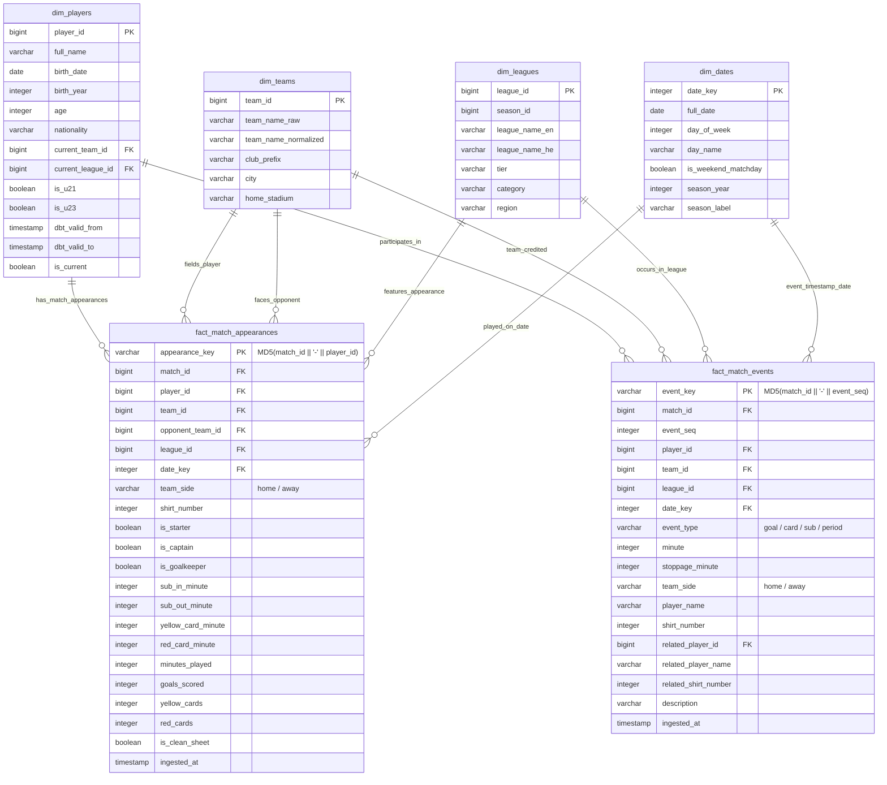

# Architecture & Data Warehouse Design: `il-scout-engine`

This document defines the architectural blueprints, storage contracts, and dimensional data models for the Israeli Lower-League & Youth Football Scouting Pipeline (`il-scout-engine`).

---

## 1. End-to-End Lakehouse Architecture

The system implements a decoupled cloud lakehouse architecture spanning four distinct layers:

```
[IFA Portal (football.org.il)]
             │
             ▼ (Async Playwright + selectolax / bs4 + Pydantic v2)
┌───────────────────────────────────────────────────────────┐
│ Layer 1: Bronze (Immutable Hive-Partitioned Parquet)      │
│ • Local: data/bronze/season_id=<ID>/league_id=<ID>/       │
│ • Cloud: Cloudflare R2 / AWS S3                           │
│ • Watermark: Skip existing match_ids, --lookback-days     │
│ • Player Bio Cache & etl_run_logs.parquet                 │
└───────────────────────────────────────────────────────────┘
             │
             ▼ (dbt-duckdb / MotherDuck)
┌───────────────────────────────────────────────────────────┐
│ Layer 2: Silver (Kimball Star Schema Data Warehouse)      │
│ • Facts: fact_match_appearances, fact_match_events        │
│ • Dims: dim_players (SCD2), dim_teams, dim_leagues, dates │
│ • Idempotent MERGE on unique keys                         │
└───────────────────────────────────────────────────────────┘
             │
             ▼ (dbt analytical models & window functions)
┌───────────────────────────────────────────────────────────┐
│ Layer 3: Gold (Analytical & Scouting Marts)               │
│ • mart_player_season_stats                                │
│ • mart_breakout_prospects (npg_per_90, z_score, breakout)│
│ • Automated dbt tests (schema + singular constraints)     │
└───────────────────────────────────────────────────────────┘
             │
             ▼
┌───────────────────────────────────────────────────────────┐
│ Layer 4: Consumption & Intelligence                       │
│ • AI Analyst: Anthropic Claude grounded scouting digest   │
│ • Streamlit Explorer: Radar, SCD2 transfer timeline, logs │
└───────────────────────────────────────────────────────────┘
```

---

## 2. Kimball Star Schema (Silver Layer)

The Silver warehouse transforms raw Bronze match and player data into a clean, query-optimized Kimball Star Schema.

### Fact Tables
1. **`fact_match_appearances`**:
   * **Grain:** 1 row per `(match_id, player_id)`
   * **Strategy:** Incremental `merge` on `['match_id', 'player_id']`
   * **Metric Logic:** Computes exact `minutes_played` accounting for `is_starter`, `sub_in_minute`, `sub_out_minute`, and `red_card_minute`. Tracks goals, cards, and clean sheets.
2. **`fact_match_events`**:
   * **Grain:** 1 row per `(match_id, event_seq)`
   * **Strategy:** Incremental `merge` on `['match_id', 'event_seq']`
   * **Event Types:** `goal`, `own_goal`, `penalty`, `yellow_card`, `red_card`, `substitution`, `period_start`, `period_end`.

### Dimension Tables
1. **`dim_players` & `snap_players_scd2`**:
   * **Grain:** `player_id` (current snapshot) and `(player_id, dbt_scd_id)` (SCD Type 2 history).
   * **SCD2 Logic:** Managed via `dbt snapshot` checking `['current_team_id', 'current_league_id']` with valid-from / valid-to dates so historical performance maps to the club represented on matchday.
2. **`dim_teams`**:
   * **Grain:** `team_id`
   * **Normalization:** Standardized via macros stripping common Hebrew prefixes (`מ.ס.`, `מ.כ.`, `עירוני`, `הפועל`, `מכבי`, `בית"ר`) and commercial sponsor suffixes.
3. **`dim_leagues`**:
   * **Grain:** `league_id`
   * **Coverage:** Parameterized via `config/leagues.yaml` across the 10 target divisions.
4. **`dim_dates`**:
   * **Grain:** `date_key` (`YYYYMMDD`)

---

## 3. Entity-Relationship Diagram (Mermaid ERD)



---

## 4. Analytical Marts (Gold Layer)

1. **`mart_player_season_stats`**:
   * Aggregates match appearances to season totals per player, league, and team.
   * Total minutes, starts, sub appearances, goals, yellow/red cards, points per match.

2. **`mart_breakout_prospects`**:
   * Filters for U21/U23 prospects (`age <= 23` and `minutes_played >= 270`).
   * Window functions over 5-match rolling windows (`ROWS BETWEEN 4 PRECEDING AND CURRENT ROW`):
     * `npg_per_90`: Non-penalty goals per 90 minutes.
     * `team_goal_share_pct`: Goals scored by prospect / total team goals while on pitch.
     * `league_z_score`: Standardized goalscoring rate within league & age tier.
     * `is_u21_ironman`: Played 90+ minutes in `>= 80%` of eligible matches.
     * `is_sudden_role_breakout`: Shifted from bench (< 30 min) to consistent starter (> 75 min).
     * `is_youth_senior_callup`: U19 player registered and playing in Senior Tier 3–5.
     * `breakout_index`: Composite score (`0–100`) ranking talent for scouts.
